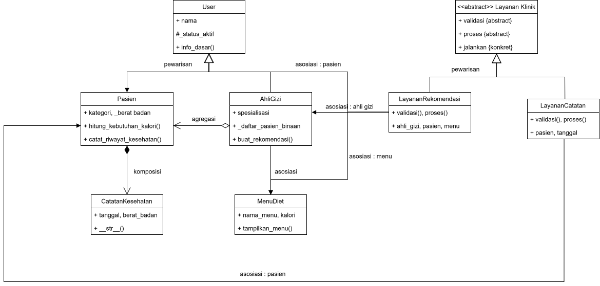
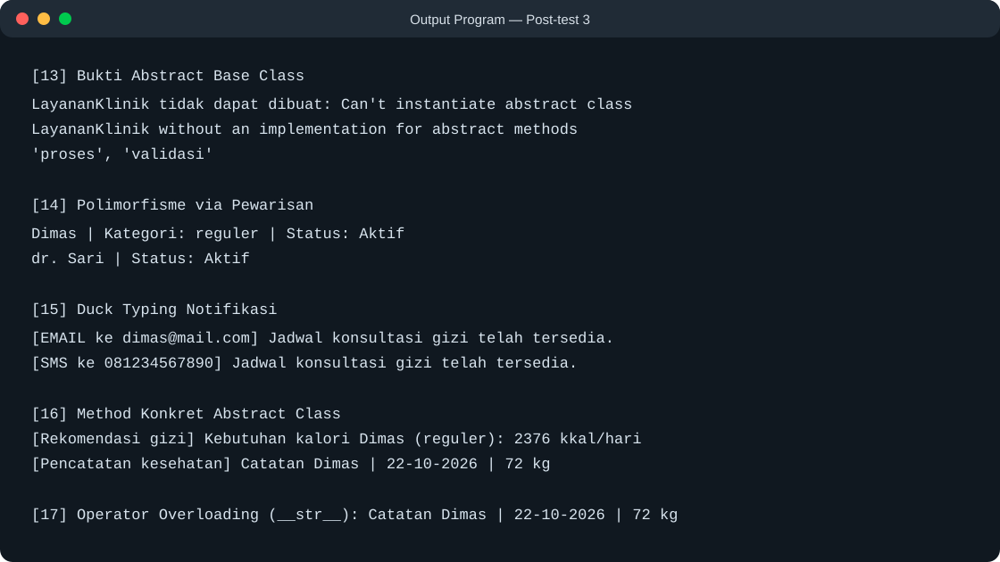

# Sistem Informasi Gizi — Post-test 3

**Nama:** Muhammad Zaki Fahriansyah  
**NIM:** 2509106020  
**Kelas:** A1'25

## Deskripsi
Program klinik gizi ini melanjutkan sistem Post-test 2 untuk mengelola pasien, ahli gizi, menu diet, dan catatan kesehatan, dengan penerapan abstraksi, polimorfisme, relasi objek, dan prinsip OCP.

## Class Diagram



### Relasi kelas
- **Asosiasi — `AhliGizi` dengan `Pasien` dan `MenuDiet`:** `AhliGizi.buat_rekomendasi()` menerima pasien dan menu sebagai parameter saat menyusun rekomendasi; objek tersebut tidak disimpan sebagai kepemilikan permanen.
- **Agregasi — `AhliGizi` dengan `Pasien`:** pasien dibuat secara mandiri lalu dapat dicatat pada `_daftar_pasien_binaan`; pasien tetap dapat hidup dan digunakan tanpa objek ahli gizi tersebut.
- **Komposisi — `Pasien` dengan `CatatanKesehatan`:** catatan dibuat oleh `Pasien.catat_riwayat_kesehatan()` dan dikelola di `_riwayat_kesehatan` sebagai bagian riwayat kesehatan pasien.
- **Pewarisan — `LayananKlinik` dengan `LayananRekomendasi` dan `LayananCatatan`:** kelas turunan memenuhi kontrak abstrak dan menggunakan alur konkret `jalankan()`.

## Abstraksi
`LayananKlinik` mewarisi `ABC` dan menetapkan `validasi()` serta `proses()` sebagai abstract method. `LayananRekomendasi` dan `LayananCatatan` mengimplementasikan kedua method tersebut; keduanya memakai method konkret `jalankan()`. Program mencoba menginstansiasi `LayananKlinik`, lalu menangkap `TypeError` sebagai bukti kelas abstrak tidak dapat dibuat langsung.

## Polimorfisme
- **Pewarisan:** `Pasien` dan `AhliGizi` meng-override `User.info_dasar()` dengan perilaku berbeda, lalu dipanggil melalui satu loop.
- **Duck typing:** `EmailNotifikasi` dan `SMSNotifikasi` tidak berhubungan lewat inheritance, tetapi sama-sama memiliki `kirim(pesan)` dan diproses fungsi `kirim_notifikasi()`.
- **Operator overloading:** `CatatanKesehatan.__str__()` mengatur tampilan objek catatan ketika dicetak.
- Kode memakai method objek untuk perilakunya, bukan membedakannya dengan `type()` atau rantai kondisi jenis objek.

## SOLID — Nilai Plus
Prinsip **Open/Closed (OCP)** tampak pada `LayananKlinik`: alur umum disediakan `jalankan()`, sedangkan variasi ditambahkan lewat subclass yang mengimplementasikan `validasi()` dan `proses()`. Penambahan layanan seperti rekomendasi atau pencatatan tidak perlu mengubah alur umum tersebut.

## Bukti Output
Jalankan dari folder ini dengan `python 2509106020-MuhammadZakiFahriansyah-PT-3.py`.



Bukti abstraksi yang tampil saat program berjalan:

```text
[13] Bukti Abstract Base Class
LayananKlinik tidak dapat dibuat: Can't instantiate abstract class LayananKlinik without an implementation for abstract methods 'proses', 'validasi'
```

## Menjalankan Program
```bash
python 2509106020-MuhammadZakiFahriansyah-PT-3.py
```
